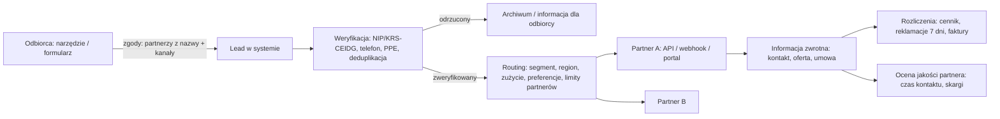
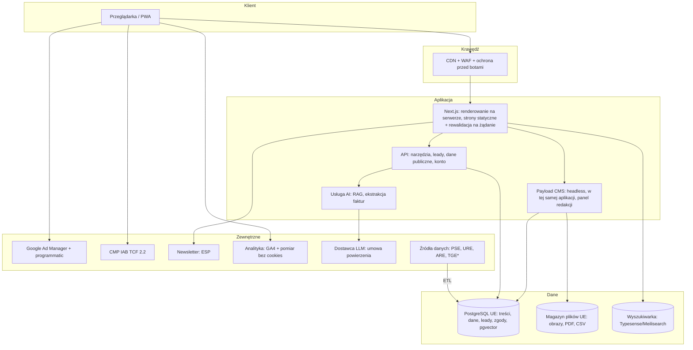
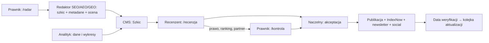

# Energypedia.pl – architektura serwisu

**Wersja:** 1.0 · **Data:** 21 października 2026 r. · **Powiązane dokumenty:** `BIZNESPLAN_Energypedia.md`, `PLAN_MVP_do_konca_2026.md`, `zespol/06_redaktor_seo_aeo_geo.md`, `zespol/07_prawnik.md`

> **Cel dokumentu:** jedna, spójna specyfikacja dla wykonawcy serwisu, redakcji i sprzedaży. Opisuje architekturę informacji, wzorce stron, model treści, doświadczenie użytkownika, architekturę techniczną, **architekturę reklamową i partnerską**, prywatność i bezpieczeństwo, wydajność, SEO/AEO/GEO oraz etapy wdrożenia (MVP grudzień 2026 r. → 2028 r.).

---

## Spis treści

1. Zasady projektowe (światowe trendy 2026 i jak je stosujemy)
2. Architektura informacji: mapa serwisu, adresy, nawigacja, taksonomia
3. Typy stron (szablony) i ich budowa
4. Model treści (CMS)
5. Doświadczenie użytkownika i system projektowy
6. Narzędzia, dane i AI
7. Architektura reklamowa i partnerska (sprzedaż powierzchni)
8. Leady i portal partnera
9. Architektura techniczna
10. SEO, AEO, GEO i gotowość dla agentów AI
11. Wydajność, dostępność, jakość
12. Prywatność, zgody, bezpieczeństwo, zgodność prawna
13. Przepływ pracy redakcji (z wirtualnym zespołem)
14. Pomiar i analityka
15. Etapy wdrożenia i budżet
16. Decyzje architektoniczne (ADR) i ryzyka

---

## 1. Zasady projektowe (światowe trendy 2026 i jak je stosujemy)

| # | Trend (stan praktyki 2025–2026) | Jak go stosujemy w Energypedii |
|---|---|---|
| 1 | **Odpowiedź najpierw** (answer-first) i treści „żywe” (living content) | Każda strona zaczyna się od odpowiedzi; trackery „na bieżąco”, dziennik zmian, daty weryfikacji |
| 2 | **Wyszukiwanie wspierane AI** z cytowaniem źródeł (RAG) | Wyszukiwarka hybrydowa (słowa + znaczenie) i asystent „Zapytaj Energypedię”, który odpowiada wyłącznie na podstawie naszych treści, z przypisami |
| 3 | **Dziennikarstwo danych i interaktywność** | Wykresy interaktywne, kalkulatory w treści, „przewijane historie” dla analiz, osadzane wykresy dla mediów (embed z linkiem) |
| 4 | **Personalizacja bez logowania** | Przełącznik segmentu: Dom / Mikrofirma / MŚP / Duża firma i samorząd oraz region (OSD). Zmienia przykłady, wezwania do działania i kolejność treści; zapamiętywany lokalnie, bez profilowania reklamowego |
| 5 | **Wydajność jako funkcja produktu** | Renderowanie na serwerze ze strumieniowaniem, statyczne strony evergreen, CDN na krawędzi, budżety wydajności, Speculation Rules (wstępne ładowanie), View Transitions (płynne przejścia) |
| 6 | **Dostępność jako standard** | WCAG 2.2 AA (wymóg Europejskiego aktu o dostępności), tryb ciemny, ograniczony ruch (prefers-reduced-motion), czytelność danych |
| 7 | **Prywatność od projektu** | Reklama kontekstowa i dane własne (first-party) zamiast śledzenia; CMP zgodna z IAB TCF; minimalizacja danych |
| 8 | **Wiarygodność widoczna na stronie** (E-E-A-T, przejrzystość) | Autor, recenzent, źródła, metodyka, „Jak pracujemy”, „Jak zarabiamy”, rejestr sprostowań, oznaczenia materiałów partnerów |
| 9 | **Wieloformatowość** | Artykuł + wersja audio (lektor syntetyczny, oznaczony), krótkie wideo, newsletter, podcast; jedna treść, wiele kanałów |
| 10 | **Gotowość dla agentów AI** (agent-ready web) | Czysta struktura HTML, dane strukturalne, publiczne API danych, pliki CSV, kanały RSS, `llms.txt` (opcjonalnie); w przyszłości serwer MCP z danymi Energypedii |
| 11 | **Własne kanały** (owned audience) | Newsletter, konta z zapisanymi kalkulacjami i alertami, PWA (instalowalna strona), powiadomienia o zmianach taryf |
| 12 | **Monetyzacja przyjazna czytelnikowi** | Mała gęstość reklam, stałe rozmiary slotów (zero przeskoków układu), brak wyskakujących okien, sponsoring treści zamiast „zalewu” bannerów, PRO bez reklam |
| 13 | **Bezgłowy CMS (headless) i komponowalność** | Treść w CMS jako ustrukturyzowane bloki, wielokanałowa dystrybucja (strona, newsletter, API, social media) |

**Zasada nadrzędna:** najpierw zaufanie i użyteczność, potem monetyzacja. Każda decyzja reklamowa jest sprawdzana pytaniem: „Czy to obniża wiarygodność lub wydajność?”.

---

## 2. Architektura informacji

### 2.1. Mapa serwisu (poziom 1–2)

```
energypedia.pl
├── /                                   Strona główna (spersonalizowana segmentem)
├── /wiadomosci/                        Newsy (lista, filtry: temat, segment, region)
│   └── /wiadomosci/{slug}
├── /analizy/                           Analizy danych, komentarze, opinie
│   └── /analizy/{slug}
├── /przewodniki/                       Strony przewodnie (filary) – 10 obszarów
│   └── /przewodniki/{obszar}           np. /przewodniki/rachunek-za-prad
├── /poradniki/                         Poradniki krok po kroku, porównania, zestawienia
│   └── /poradniki/{slug}
├── /wiedza/                            Encyklopedia (hasła A–Z)
│   └── /wiedza/{haslo}                 np. /wiedza/oplata-mocowa
├── /na-biezaco/                        Trackery (żywe strony)
│   └── /na-biezaco/{slug}              np. /na-biezaco/taryfy-na-prad, /na-biezaco/csire
├── /dane/                              Barometr, Temperatura rachunku, Index, zbiory danych, metodyki
│   ├── /dane/barometr-rynku/{rrrr-mm}
│   ├── /dane/barometr-odbiorcow/{rrrr-kw}
│   ├── /dane/temperatura-rachunku
│   ├── /dane/{zbior}                   (CSV, API, licencja)
│   └── /dane/metodyka/{wskaznik}
├── /narzedzia/                         Kalkulatory i narzędzia (od I kw. 2027 r.)
│   ├── /narzedzia/analizator-faktury
│   ├── /narzedzia/porownywarka
│   ├── /narzedzia/zapytanie-ofertowe
│   ├── /narzedzia/kalkulator-taryf
│   ├── /narzedzia/fotowoltaika-magazyn
│   └── /narzedzia/ladowanie-ev
├── /dla-domu/  /dla-firm/              Huby segmentów
│   └── /dla-firm/mikro | /msp | /duze-i-samorzady
├── /regiony/                           16 województw → miasta
│   └── /regiony/{wojewodztwo}/{miasto}
├── /sprzedawcy/                        Katalog sprzedawców energii (MVP: 5 sprzedawców z urzędu)
│   └── /sprzedawcy/{sprzedawca}        Profil: obszar, taryfa lub cennik, OWU, decyzje URE i UOKiK, kontakt
├── /operatorzy/                        Katalog operatorów sieci (MVP: 5 dużych OSD) + mapa obszarów
│   └── /operatorzy/{osd}               Profil: obszar, taryfa dystrybucyjna, przyłącza, awarie, SAIDI/SAIFI, kontakt
├── /rankingi/                          Rankingi ofert i firm według jawnej metodyki (od 2027 r.)
│   └── /rankingi/{kategoria}           np. /rankingi/sprzedawcy-pradu, /rankingi/oferty-pradu-dla-domu
├── /zestawienia/{kategoria}            Porównania parametrów produktów: panele, falowniki, magazyny energii (od 2027 r.)
├── /gaz/                               Dział gazu (od II kw. 2027 r.): sprzedawcy, PSG i operatorzy, taryfy, rachunek za gaz
├── /branze/{branza}                    Energia dla branż (piekarnie, HoReCa, warsztaty…)
├── /tematy/{tag}                       Strony tematów (agregaty)
├── /autorzy/{slug}  /eksperci/         Autorzy, Rada Ekspertów
├── /wzory-pism/{slug}                  Wzory dokumentów do pobrania
├── /partnerzy/                         Materiały partnerów (oznaczone) i strony partnerów
│   └── /partnerzy/{partner}/{slug}
├── /wydarzenia/                        Webinary, śniadania energetyczne, kongres
├── /newsletter  /pro  /konto           Subskrypcje, abonament, konto
├── /prasa/                             Pokój prasowy (wykresy, komunikaty, kontakt)
├── /reklama/                           Media kit, formaty, cennik, kontakt (dla reklamodawców)
├── /partnerstwa-leadowe/               Program dla sprzedawców energii i instalatorów (B2B)
└── /o-nas  /redakcja  /jak-pracujemy  /jak-zarabiamy  /sprostowania  /regulamin  /prywatnosc  /dostepnosc  /kontakt
```

### 2.2. Zasady adresów (URL)
- Krótkie, po polsku, bez polskich znaków, małe litery, myślniki; **bez dat i lat** w treściach evergreen (rok tylko w danych: `/dane/barometr-rynku/2026-12`).
- Jedna intencja = jeden adres; przekierowania 301 przy łączeniu treści; kanoniczne adresy dla wariantów.
- Parametry filtrów (`?segment=firma`) nieindeksowane (canonical do wersji bazowej); strony wyników wyszukiwania wewnętrznego z `noindex`.
- Paginacja list z prawidłowymi linkami; archiwa newsów według miesięcy.

### 2.3. Nawigacja
- **Nagłówek:** logo · Wiadomości · Wiedza (mega-menu: Przewodniki, Poradniki, Encyklopedia, Wzory pism) · Dane · Narzędzia · Regiony · **[Przełącznik: Dom | Firma]** · Szukaj (z AI) · Newsletter.
- **Mega-menu Wiedza:** 10 obszarów tematycznych (rachunek; taryfy i ceny; umowy i zmiana sprzedawcy; energia dla firm; prosumenci i OZE; magazyny, pompy, EV; rynek i system; prawo; samorządy i społeczności; regiony).
- **Okruszki** na każdej stronie; **„Czytaj dalej”** sterowane relacjami w CMS (nie tylko tagami).
- **Stopka:** strony zaufania (Jak pracujemy, Jak zarabiamy, Sprostowania, Redakcja), Reklama, Partnerstwa, Prasa, RSS, API danych, dostępność, prywatność.
- **Telefon:** dolny pasek (Szukaj, Wiedza, Narzędzia, Newsletter), menu pełnoekranowe.

### 2.4. Taksonomia
| Wymiar | Wartości | Zastosowanie |
|---|---|---|
| Obszar (10) | rachunek, taryfy-ceny, umowy, firmy, prosumenci-oze, magazyny-pompy-ev, rynek-system, prawo, samorzady-spolecznosci, regiony | Nawigacja, filary, targetowanie reklam |
| Segment (4) | dom, mikro, msp, duze-samorzady | Personalizacja, CTA, targetowanie |
| Region | 16 województw, OSD | Strony regionalne, treści lokalne, reklama regionalna |
| Typ treści | news, analiza, opinia, przewodnik, poradnik, porównanie, lista, hasło, tracker, dane, wzór, partner | Szablony, schema, raporty |
| Tagi (kontrolowane) | Słownik ok. 300 pojęć powiązanych z hasłami | Linkowanie, strony tematów |
| Encje | Instytucje (URE, PSE…), firmy, akty prawne, programy | Dane strukturalne, linkowanie, GEO |


### 2.5. Katalogi, rankingi i dział gazu

**Katalog sprzedawców energii (`/sprzedawcy/`, w MVP).** Na start 5 profili sprzedawców z urzędu: PGE Obrót, TAURON Sprzedaż, Enea i Energa Obrót (taryfy na 2026 r. zatwierdził Prezes URE) oraz E.ON na obszarze Stoen Operator (taryfa niezatwierdzana przez Prezesa URE). [DO WERYFIKACJI: pełne nazwy spółek i obszary w zestawieniu URE „Masz wybór”]
- Profil zawiera wyłącznie dane publiczne ze źródłem i datą: obszar sprzedawcy z urzędu, taryfa lub cennik dla gospodarstw domowych, ogólne warunki umowy, kanały kontaktu i reklamacji, decyzje Prezesa URE i UOKiK dotyczące spółki, link do porównywarki ofert Prezesa URE.
- Strona zbiorcza `/sprzedawcy/` wyjaśnia, czym jest sprzedawca z urzędu i jak sprawdzić swojego; po 2027 r. katalog rozszerzamy o sprzedawców z listy URE.
- Po decyzji URE o taryfach na 2027 r. profile aktualizujemy w ciągu 24 godzin (powiązanie z trackerem `/na-biezaco/taryfy-na-prad`).

**Katalog operatorów sieci (`/operatorzy/`, w MVP).** Na start 5 dużych operatorów: PGE Dystrybucja, TAURON Dystrybucja, Enea Operator, Energa-Operator, Stoen Operator. [DO WERYFIKACJI: aktualne nazwy w wykazie URE] Profil: obszar działania (mapa na podstawie danych operatorów, jeśli licencja na to pozwala), taryfa dystrybucyjna i opłaty, przyłączenie, zgłaszanie awarii i planowane wyłączenia, wskaźniki niezawodności SAIDI i SAIFI z raportów URE, kontakt. Mali operatorzy z wykazu URE w 2027 r.

**Profile partnerów: płatna strefa w profilu firmy (sprzedaż od 2027 r., [termin do decyzji naczelnego]).** Makiety: plansze „Profil sprzedawcy”, „Profil operatora sieci” i „Profile firm · pakiety i zasady edycji” (`makiety/`).
- **Dwie strefy.** Strefa redakcji (taryfa, audyt umowy, obsługa, decyzje urzędów; u operatora także wyłączenia, opłaty, przyłączenie, SAIDI i SAIFI) jest zawsze i firma jej nie edytuje. Strefa partnera (opis, oferty, aktualności, wideo, formularz B2B) ma etykietę „Materiał partnera · treści przygotował [firma]”, tło w kolorze materiałów partnera i linki `rel="sponsored"`.
- **Pakiety:** bez umowy (pełny profil redakcyjny i zachęta „Zweryfikuj profil”), Profil Plus (logo, oznaczenie „Profil zarządzany przez firmę”, opis do 600 znaków, do 3 ofert, podstawowe statystyki), Profil Premium (dodatkowo opis do 1500 znaków z wyróżnikami, wideo lub zdjęcie, aktualności, formularz zapytań B2B, pełne statystyki). Ceny ustala Handlowiec z naczelnym; nie podajemy ich w makietach.
- **Edycja w portalu partnera (rozdz. 8):** weryfikacja firmy (umowa, osoba upoważniona, e-mail w domenie firmy) → edycja przez role „właściciel konta” i „redaktor firmy” z podglądem → moderacja redakcji (zgodność oferty z cennikiem i warunkami, oznaczenia, język, [x] dni roboczych) → publikacja z historią wersji; oferta znika automatycznie po dacie końca.
- **Pola oferty:** nazwa, cena i jednostka, okres umowy, opłaty dodatkowe, data końca, link do regulaminu; przy obniżce najniższa cena z 30 dni przed obniżką. [DO WERYFIKACJI: Prawnik, czy obowiązek dotyczy sprzedaży energii, oraz wymogi oznaczania reklamy]
- **Nienaruszalne:** pakiet nie zmienia kolejności w porównywarce, rankingach ani listach; brak ocen i opinii dodawanych przez firmę; błąd w strefie redakcji firma zgłasza z dowodem przez „zgłoś błąd”, a poprawka trafia do rejestru korekt; numer pogotowia energetycznego operatora widoczny zawsze, niezależnie od pakietu.
- **Model treści (CMS):** typ `organizacja` (dane redakcji) i powiązany typ `profil_partnera` (pola strefy partnera, pakiet, daty umowy, status moderacji, wersje); po wygaśnięciu umowy strefa partnera znika, a profil wraca do wariantu „bez umowy”.

**Rankingi (`/rankingi/`) i zestawienia (`/zestawienia/`, od 2027 r.).**
- Ranking ofert: kolejność według całkowitego kosztu dla podanego profilu zużycia (porównywarka).
- Ranking sprzedawców jako firm: jawna metodyka (ceny, uczciwość zapisów umów według audytu redakcji, decyzje URE i UOKiK, test obsługi), wagi opublikowane przed rankingiem.
- Panele, falowniki, magazyny energii: „zestawienia” parametrów z kart katalogowych (sprawność, gwarancja, cykle, cena za kWh pojemności) bez wskazywania zwycięzcy, dopóki nie mamy własnych testów.
- Firmy instalacyjne: katalog z kryteriami weryfikacji (certyfikaty, staż, ubezpieczenie), bez rankingu jakości.
- Zasady: metodyka i data danych na każdej stronie; płatność i relacje leadowe nie wpływają na kolejność; informacja o głównych parametrach decydujących o kolejności (wymóg przepisów o nieuczciwych praktykach rynkowych, [DO WERYFIKACJI: Prawnik]); bez reklam firm z tej samej kategorii (ADR-4); bez ocen gwiazdkowych w danych strukturalnych bez własnych, udokumentowanych ocen.

**Dział gazu (`/gaz/`, od II kw. 2027 r.).** Sprzedawcy gazu i sprzedawca z urzędu, Polska Spółka Gazownictwa (PSG) i inni operatorzy, taryfy gazowe zatwierdzane przez Prezesa URE, rachunek za gaz, ogrzewanie (porównanie z pompą ciepła). Mapę sieci PSG pokazujemy jako link lub osadzenie tylko na warunkach licencji PSG; własna mapa wyłącznie z danych, które wolno wykorzystać. [DO WERYFIKACJI: licencja danych PSG, aktualne nazwy sprzedawców gazu]

**Dane strukturalne:** profil firmy to `WebPage` z `about` → `Organization` (nazwa, adres, `sameAs` do oficjalnej strony) i `BreadcrumbList`; ranking to `ItemList` + `Article` z metodyką; zestawienie to `ItemList` + `Product` bez `AggregateRating`.

---

## 3. Typy stron (szablony) i ich budowa

Wspólne elementy każdej strony treści: okruszki · nadtytuł (obszar/segment) · H1 · lead-odpowiedź · ramka „W skrócie” · metryka (autor, recenzent, daty, czas czytania, **wersja audio**) · spis treści · treść blokowa · FAQ · źródła · dziennik zmian · nota o autorze · powiązane · zapis do newslettera · CTA do narzędzia.

### 3.1. Szablony i miejsca reklamowe (schematy układu)

**Artykuł / poradnik / hasło (komputer)**
```
┌──────────────────────────────────────────────────────────────┐
│ NAGŁÓWEK + nawigacja                         [Dom | Firma]   │
├──────────────────────────────────────────────────────────────┤
│ [AD: EP_TOP_BILLBOARD 970×250 / 750×200]  (zarezerwowana wys.)│
├──────────────────────────────────────┬───────────────────────┤
│ Okruszki · Nadtytuł · H1             │ Spis treści (sticky)  │
│ Lead-odpowiedź · W SKRÓCIE           │                       │
│ Autor · Recenzent · Daty · ▶ Audio   │ [AD: EP_SIDEBAR_HP    │
│ Treść (H2…)                          │  300×600, sticky]     │
│ [AD: EP_INARTICLE_1 300×250 / natyw.]│                       │
│ Tabela · Wykres · Kalkulator w treści│ [Partner działu: logo]│
│ Co to znaczy dla Ciebie? (segmenty)  │ (sponsoring akademii) │
│ [AD: EP_INARTICLE_2] (po 2. bloku H2)│                       │
│ FAQ · Źródła · Dziennik zmian        │ Newsletter            │
│ [NATIVE: EP_NATIVE_RECO – „Polecane  │                       │
│  od partnerów” – oznaczone]          │                       │
│ Powiązane treści (redakcyjne)        │                       │
├──────────────────────────────────────┴───────────────────────┤
│ STOPKA                                                        │
└──────────────────────────────────────────────────────────────┘
```

**Artykuł (telefon)**
```
NAGŁÓWEK
H1 · Lead · W skrócie            ← pierwszy ekran BEZ reklamy (lepsze wskaźniki i doświadczenie)
Treść…
[AD: EP_M_INARTICLE_1 300×250]   ← po 3. akapicie, rezerwacja wysokości
Treść…
[AD: EP_M_INARTICLE_2 300×250 / 300×600]
FAQ · Źródła
[NATIVE: polecane od partnerów]
[AD: EP_M_STICKY 320×50, zamykany, max 1 na sesję, ≤ 15% ekranu]
```

**Strona główna**
```
Hero: „Rachunek bez tajemnic” + wyszukiwarka z AI + przełącznik segmentu
Pas danych: Temperatura rachunku · RDN wczoraj · Taryfa · Godziny z ceną ujemną (live)
[AD: EP_HP_BILLBOARD]
Najważniejsze dziś (newsy) | Trackery „na bieżąco”
Dla Ciebie (segment): przewodnik + narzędzie + poradnik
[NATIVE: EP_HP_NATIVE_1 w siatce – oznaczony „Materiał partnera”]
Barometr (wykres) · Analizy
[Sponsor działu: „Akademia magazynów energii – partner: X”]
Regiony (mapa) · Wydarzenia · Newsletter
```

**Narzędzie (porównywarka, analizator, zapytanie ofertowe) – strefa neutralna**
```
H1 · Wyjaśnienie metodyki · Formularz → Wynik
[BRAK reklam sprzedawców energii w obrębie narzędzia i wyników]
Pod wynikiem: „Chcesz oferty? Wyślij zapytanie do wybranych partnerów” (lead; jawna lista partnerów i informacja „Jak zarabiamy”)
Dozwolone poniżej: [AD: EP_TOOL_BOTTOM] tylko kategorie niekonfliktowe (np. banki, OZE, efektywność) + sponsor narzędzia z kategorii niekonfliktowych
```

**Tracker „na bieżąco”**: nagłówek „Ostatnia aktualizacja: data, godzina” · stan aktualny (tabela) · oś czasu zmian · FAQ · zapis na alert e-mail · [AD: EP_INARTICLE_1] po stanie aktualnym.

**Dane / Barometr**: kafle liczb · wykresy interaktywne (pobierz PNG/SVG/CSV, osadź) · komentarz · metodyka · **Partner Barometru** (logo, bez wpływu na wyniki) · [AD: EP_TOP_BILLBOARD].

**Region / OSD / branża**: dane lokalne (stawki OSD, sprzedawca z urzędu, dotacje) · wydarzenia w regionie · [AD: EP_REGION_PARTNER] (Partner regionu) · lokalne newsy.

**Materiał partnera** (`/partnerzy/{partner}/{slug}`): wyraźna etykieta „Materiał partnera / Reklama” nad tytułem i w metadanych; logo partnera; ramka „Ten materiał przygotował partner. Redakcja nie odpowiada za jego treść” (lub „przygotowany przez studio treści na zlecenie”); linki `rel="sponsored"`; brak reklam konkurencji partnera; wyłączony z rekomendacji redakcyjnych.

### 3.2. Zasady gęstości i jakości reklam
- Zgodność ze standardami **Coalition for Better Ads**: bez wyskakujących okien, bez reklam pełnoekranowych z odliczaniem, bez autoodtwarzania wideo z dźwiękiem, sticky na telefonie do około 30% ekranu (u nas ≤ 15%).
- **Gęstość:** maksymalnie 1 reklama na około 3 ekrany treści na telefonie; maksymalnie 4 sloty display + 1 natywny na stronie artykułu na komputerze.
- **Zero przeskoków układu (CLS):** każdy slot ma zarezerwowaną wysokość; przy braku reklamy slot zwija się tylko poniżej widocznego obszaru albo pokazuje reklamę własną (house ad: newsletter, PRO, wydarzenie).
- **Leniwe ładowanie** slotów poniżej pierwszego ekranu; odświeżanie tylko slotów widocznych, maksymalnie co 30–60 s, zgodnie z zasadami serwera reklam i umowami z reklamodawcami.
- **PRO = bez reklam display** (sponsoring i materiały partnerów pozostają oznaczone, bo są częścią treści).

---

## 4. Model treści (CMS)

### 4.1. Typy treści i najważniejsze pola

| Typ | Kluczowe pola |
|---|---|
| **Artykuł** (news, analiza, opinia, przewodnik, poradnik, porównanie, lista, tracker) | tytuł, title SEO, opis, slug, typ, obszar, segmenty[], regiony[], tagi[], encje[], lead (40–60 słów), „W skrócie”[], treść (bloki), FAQ[], źródła[] (URL, instytucja, data dostępu), autor, recenzent, prawnik (jeśli dotyczy), data publikacji, data aktualizacji, **data następnej weryfikacji**, dziennik zmian[], grafika główna (≥ 1200 px, alt), audio, status, ocena jakości (0–100), flagi reklamowe (brand_safe, ad_free, sponsor_section) |
| **Hasło** (encyklopedia) | pojęcie, definicja (≤ 60 słów), synonimy, powiązane hasła, treść, liczby (tabela), podstawa prawna, daty |
| **Wzór pisma** | treść, pola do uzupełnienia, instrukcja, podstawa prawna, plik DOCX/PDF, zastrzeżenie |
| **Region / OSD / Branża** | dane lokalne (powiązania z danymi taryf), treść, wydarzenia, partner regionu |
| **Zbiór danych / Wykres** | dane (CSV/tabela), metadane (źródło, licencja, okres), typ wykresu, tytuł-teza, wersje embed |
| **Barometr** | okres, wskaźniki (powiązane zbiory), komentarz, metodyka, partner |
| **Autor / Ekspert** | biogram, kwalifikacje, zdjęcie, sameAs (LinkedIn), obszary wiedzy |
| **Źródło / Akt prawny** | nazwa, instytucja, sygnatura, link (ISAP/ELI/EUR-Lex), stan prawny na dzień (zasilane przez radar Prawnika) |
| **Partner** | nazwa, kategoria (sprzedawca energii / OZE / finanse / inne), logo, umowa (ID), wyłączenia konkurencyjne, osoba kontaktowa (poza CMS publicznym) |
| **Materiał partnera** | jak Artykuł + partner, numer zlecenia, etykieta, okres emisji, akceptacja Prawnika |
| **Pakiet sponsorski** | partner, typ (dział, newsletter, barometr, region, narzędzie), zakres stron/tagów, okres, elementy (logo, tekst), status |
| **Wydarzenie** | data, miejsce/online, agenda, prelegenci, partnerzy, rejestracja |
| **Narzędzie (konfiguracja)** | parametry, teksty, metodyka, wersja silnika obliczeń |

### 4.2. Bloki treści (komponowalne)
Akapit · nagłówek-pytanie · lista kroków · tabela danych · wykres (z biblioteki) · kalkulator osadzony · ramka „Co to znaczy dla Ciebie?” (warianty segmentów) · cytat eksperta · ramka ostrzeżenie/pułapka · FAQ · wzór pisma (pobierz) · CTA (narzędzie/newsletter) · **slot reklamowy w treści** (pozycja wyznaczana automatycznie według reguł, redakcja może go zablokować) · embed (YouTube, post) · oś czasu (tracker).

### 4.3. Statusy i role w CMS
`Szkic → Recenzja merytoryczna → Kontrola prawna (warunkowo) → Akceptacja naczelnego → Zaplanowane → Opublikowane → Do weryfikacji (data) → Zaktualizowane / Zarchiwizowane`
Role: Naczelny (wszystko), Redaktor (szkice), Recenzent/Prawnik (komentarze, statusy recenzji), Sprzedaż (materiały partnerów, pakiety, bez dostępu do treści redakcyjnych w edycji), Analityk (dane i wykresy). Pełna historia wersji i ślad audytowy (kto, kiedy, co).

---

## 5. Doświadczenie użytkownika i system projektowy

- **Mobile-first** (większość ruchu z telefonów), siatka responsywna z **container queries**, czytelna typografia (16–18 px w treści, interlinia około 1,6, długość wiersza około 65–75 znaków).
- **Tryb jasny i ciemny** (tokeny kolorów), wysoki kontrast, **paleta wykresów odporna na zaburzenia widzenia barw**.
- **System komponentów** (biblioteka UI z dokumentacją): karty treści, kafle danych, tabele z sortowaniem, wykresy, formularze, ramki, sloty reklamowe jako komponenty z etykietą „Reklama”.
- **Mikrointerakcje z umiarem:** View Transitions między stronami, animacje danych przy wejściu w widok, respektowanie `prefers-reduced-motion`.
- **Personalizacja segmentu:** przełącznik w nagłówku i na stronie; zmienia warianty bloków „Co to znaczy dla Ciebie?”, przykłady liczbowe i CTA; przechowywany w pamięci przeglądarki (preferencja funkcjonalna, nie śledzenie).
- **Wyszukiwarka:** natychmiastowe podpowiedzi (hasła, poradniki, narzędzia), wyniki pogrupowane według typów, **odpowiedź AI z przypisami** na górze dla pytań.
- **Czytanie:** wersja audio, tryb skupienia, zapis do przeczytania (konto), udostępnianie fragmentu z cytatem i linkiem.
- **Konto (od I kw. 2027 r.):** logowanie bez hasła (link e-mail, passkeys); zapisane kalkulacje, alerty (taryfy, koniec umowy), preferencje newslettera, PRO.
- **PWA:** instalowalna strona, szybki start, lista do przeczytania offline; powiadomienia push tylko po wyraźnej zgodzie i dla ważnych alertów.
- **Mikrocopy zaufania** przy formularzach: „Po co nam te dane”, „Komu je przekażemy”, link „Jak zarabiamy”.

---

## 6. Narzędzia, dane i AI

### 6.1. Narzędzia (etapowo)
| Narzędzie | Dane wejściowe | Silnik | Wynik | Monetyzacja |
|---|---|---|---|---|
| Kalkulator taryf (G11/G12/G12w/dynamiczna) | Zużycie, profil, OSD | Biblioteka taryf (testy jednostkowe dla każdej taryfy i OSD) | Koszt roczny w wariantach | CTA newsletter / lead |
| Analizator faktury | PDF/zdjęcie | OCR + LLM (ekstrakcja do schematu) + walidacja reguł | Wyjaśnienie pozycji, potencjał oszczędności | Lead (zgoda) |
| Porównywarka (TCO umowy) | Profil + oferty | Baza ofert (cenniki, wersjonowane) | Pełny koszt, ryzyka umowy | Lead |
| Generator zapytania ofertowego | PPE, profil, preferencje | Kreator + routing | Zapytanie do wybranych partnerów, porównanie odpowiedzi | Lead premium / success fee |
| PV + magazyn + pompa + EV | Zużycie, lokalizacja, dach | Model produkcji i autokonsumpcji, ceny RCE | Opłacalność, zwrot | Lead OZE |

**Zasady:** wynik w mniej niż 60 sekund; metodyka obok wyniku; wersja silnika i data danych przy wyniku; wydruk lub PDF; dane wejściowe przechowywane tylko za zgodą (faktury kasowane po 24 godzinach).

### 6.2. Warstwa danych
- **Hurtownia** (PostgreSQL + schematy analityczne): taryfy OSD i sprzedawców (wersjonowane), cenniki ofert, dane PSE/TGE (zgodnie z licencją), wskaźniki Barometru, wyniki badań.
- **ETL / harmonogramy:** codzienne pobieranie danych publicznych (PSE), comiesięczne (URE, ARE), ręczny import z walidacją (taryfy z PDF).
- **API publiczne (od II kw. 2027 r.):** `/api/v1/datasets`, `/api/v1/temperatura-rachunku`, `/api/v1/barometr` (klucz API, limity, licencja CC BY dla danych otwartych; płatne dla Index i danych PRO).
- **Osadzane wykresy** (`<iframe>` lub web component) z linkiem zwrotnym i licencją: mechanizm zdobywania linków i cytowań.

### 6.3. AI w serwisie
- **„Zapytaj Energypedię”** (RAG): indeks wektorowy (np. pgvector) z treści opublikowanych i zbiorów danych → LLM generuje odpowiedź **wyłącznie z cytowanych fragmentów**, z linkami do źródeł, datą aktualizacji i oznaczeniem „Odpowiedź wygenerowana przez AI” (AI Act). Odmowa przy pytaniach spoza zakresu lub o charakterze porady prawnej indywidualnej (odesłanie do poradnika lub Rzecznika).
- **Bezpieczeństwo:** filtry treści, ochrona przed prompt injection z treści użytkownika, limity zapytań, brak danych osobowych w logach, umowa powierzenia z dostawcą LLM i przetwarzanie w UE, jeśli to możliwe.
- **Wewnętrznie:** wsparcie redakcji (wirtualny zespół), automatyczne propozycje linków wewnętrznych, wykrywanie treści do aktualizacji, transkrypcje i wersje audio.

---

## 7. Architektura reklamowa i partnerska (sprzedaż powierzchni)

### 7.1. Model: cztery warstwy monetyzacji powierzchni
```
1. DISPLAY (sprzedaż bezpośrednia + programmatic)  → sloty IAB, serwer reklam
2. NATIVE / MATERIAŁY PARTNERÓW                     → CMS (typ „Materiał partnera”), sloty natywne
3. SPONSORING (dział, akademia, narzędzie, Barometr, region, newsletter, wydarzenie) → pakiety w CMS + komponenty logo
4. LEADY I KATALOG PARTNERÓW                        → portal partnera, routing, rozliczenia (rozdz. 8)
```

### 7.2. Inwentarz slotów (identyfikatory dla serwera reklam)

| ID slotu | Szablony | Formaty (komputer / telefon) | Sprzedaż | Uwagi |
|---|---|---|---|---|
| `EP_TOP_BILLBOARD` | wszystkie poza narzędziami | 970×250, 750×200, 728×90 / – | Bezpośrednia, programmatic | Zarezerwowana wysokość |
| `EP_SIDEBAR_HP` | artykuł, dane, region | 300×600, 300×250 (sticky w kolumnie) | Bezpośrednia, programmatic | Wysoka widoczność |
| `EP_INARTICLE_1` / `_2` | artykuł, tracker | 300×250, 336×280, natywny / 300×250, 300×600 | Bezpośrednia, programmatic | Pozycja automatyczna, redakcja może wyłączyć |
| `EP_M_STICKY` | telefon | 320×50, 320×100 | Programmatic, kampanie zasięgowe | Zamykany, ≤ 15% ekranu |
| `EP_HP_BILLBOARD` | strona główna | 970×250 / 300×250 | Bezpośrednia (pakiety „dzień na głównej”) | Premium |
| `EP_HP_NATIVE_1..2` | strona główna, listy | karta natywna | Materiały partnerów | Etykieta „Materiał partnera” |
| `EP_NATIVE_RECO` | artykuł (pod treścią) | karty natywne (1–3) | Materiały partnerów, wydarzenia | Oddzielone od „Powiązanych” redakcyjnych |
| `EP_SECTION_SPONSOR` | przewodnik/obszar, akademia | logo + tekst „Partner działu” | Sponsoring (miesięczny) | Brak wpływu na treść; zapis w „Jak zarabiamy” |
| `EP_DATA_PARTNER` | Barometr, Temperatura rachunku | logo „Partner Barometru” | Sponsoring kwartalny | Bez wpływu na metodykę |
| `EP_REGION_PARTNER` | region, miasto | logo + karta | Partner regionu | Kategorie niekonfliktowe lub sprzedawca z jawnym oznaczeniem |
| `EP_TOOL_BOTTOM` | narzędzia (pod wynikiem) | 300×250 / 728×90 | Tylko kategorie niekonfliktowe | **Brak sprzedawców energii** |
| `EP_NEWSLETTER_TOP` / `_MID` | newsletter | blok tekst + grafika | Sponsoring newslettera | Rezerwacja przez kalendarz |
| `EP_EVENT_*` | wydarzenia | logo, prelekcja, stoisko online | Pakiety wydarzeń | |
| `EP_VIDEO_PRE` (opcja 2028) | wideo w serwisie | pre-roll ≤ 15 s, pomijalny | Bezpośrednia | Tylko przy własnym wideo |

### 7.3. Technologia reklamowa (ad stack)
- **Serwer reklam:** Google Ad Manager (GAM). Kampanie bezpośrednie (pozycje sponsorowane, standard, ceny), reklamy własne (house ads), prognozowanie inwentarza i raporty.
- **Programmatic:** na start wypełnienie przez sieć Google (AdSense/AdX przez GAM, ewentualnie partnera MCM). Przy ruchu około 1 mln odsłon miesięcznie i więcej **header bidding (Prebid.js)** z 3–5 SSP (w tym polskimi i regionalnymi).
- **Pliki `ads.txt` i `sellers.json`** (u partnerów): obowiązkowe, aktualizowane przy każdej zmianie partnerów.
- **Zgody:** CMP **certyfikowana przez Google i zgodna z IAB TCF 2.2**, **Google Consent Mode v2**. Reklamy bez zgody: reklamy kontekstowe bez identyfikatorów (zgodnie z ustawieniami serwera reklam i opinią Prawnika).
- **Targetowanie (key-values):** `obszar`, `segment`, `typ`, `tag`, `region`, `osd`, `branza`, `page_id`, `brand_safe` (tak/nie), `sponsor_section`, `ad_free`, `pro` (wyklucza display), `tool_zone` (wyklucza sprzedawców energii). Targetowanie **kontekstowe i danymi własnymi** (segment wybrany przez użytkownika) zamiast śledzenia między serwisami: działa także w przeglądarkach blokujących cookies stron trzecich.
- **Brand safety i separacja konkurencji:** wykluczenia przy treściach kryzysowych (awarie, wypadki: `brand_safe=nie`); **separacja konkurencji** (dwóch sprzedawców energii nie na jednej stronie; sprzedawcy wykluczeni ze stref narzędzi i rankingów); lista blokowanych kategorii (np. hazard, pożyczki chwilówki, treści polityczne płatne bez autoryzacji).
- **Widoczność i jakość:** pomiar widoczności (standard MRC/IAB: 50% powierzchni przez 1 s dla display), weryfikacja ruchu (IVT) przez narzędzia serwera reklam; dla dużych kampanii możliwość weryfikacji niezależnej (np. Gemius, IAS, DoubleVerify) według umowy.
- **Pomiar zasięgu rynkowego:** wdrożenie skryptu **Gemius (Mediapanel/PBI)** po decyzji o przystąpieniu do badania, bo to standard planowania mediów w Polsce.

### 7.4. Materiały partnerów (native) i sponsoring: zasady architektury
- Osobny typ treści i osobna ścieżka adresów (`/partnerzy/…`), etykieta na kartach i stronie, **`rel="sponsored"`** na linkach, wykluczenie z rekomendacji redakcyjnych i z wyników asystenta AI (lub jawne oznaczenie).
- Tematy materiałów partnerów zgodne z profilem serwisu (energia, efektywność, OZE, finanse firm), przygotowane z nadzorem redakcji. To ochrona przed karą Google za nadużywanie reputacji witryny (site reputation abuse).
- Sponsoring działu: komponent logo i nota „Partner działu”; **partner nie ma dostępu do edycji treści redakcyjnych**; konfiguracja zakresu (strony, tagi, okres) w CMS i w serwerze reklam (pozycja sponsorowana na danym zakresie).
- Akceptacja każdego materiału: Recenzent (`/partner`) + Prawnik (`/kontrola`).

### 7.5. Narzędzia dla sprzedaży i reklamodawców
| Narzędzie | Etap | Opis |
|---|---|---|
| **Strona `/reklama`** (media kit online) | MVP | Formaty z podglądem, statystyki (aktualizowane z analityki), cennik bazowy, case studies, formularz zapytania |
| **Kalendarz rezerwacji** sponsoringu (newsletter, główna, Barometr, wydarzenia) | I kw. 2027 r. | Widok dostępności, rezerwacje wstępne |
| **Raport kampanii** | I kw. 2027 r. | Szablon raportu: odsłony, widoczność, kliknięcia, CTR, czytelnicy materiału, czas czytania, social media; generowany z GAM + analityki (np. Looker Studio) |
| **Panel reklamodawcy** (tylko odczyt) | III kw. 2027 r. | Bieżące wyniki kampanii, pobieranie raportów |
| **Samoobsługowy zakup** (newsletter, karty natywne) | 2028 r. | Wybór terminu, upload materiałów, akceptacja redakcji, płatność online |
| **Specyfikacje techniczne** | MVP | Formaty, wagi plików, HTML5, zasady oznaczeń, terminy dostarczenia materiałów |

### 7.6. Ekonomia inwentarza (do planowania sprzedaży)
Prognoza powierzchni: odsłony × sloty na stronę × wskaźnik wypełnienia. Przy 400 tys. wizyt i około 2 odsłonach na wizytę (≈ 800 tys. odsłon miesięcznie) i średnio 3 slotach display na odsłonę: około 2,4 mln odsłon reklam display miesięcznie (około 1,6 mln widocznych przy 65% widoczności) [założenie do weryfikacji]. Sprzedaż bezpośrednia ma pierwszeństwo, a programmatic wypełnia resztę.

---

## 8. Leady i portal partnera



- **Portal partnera (B2B):** profil i obszary obsługi, limity dzienne i miesięczne, odbiór leadów (panel, e-mail, API/webhook), statusy, reklamacje, raporty, faktury, dokumenty (umowa, standardy kontaktu).
- **Rejestr zgód** (niezmienialny dziennik): treść klauzuli i wersja, data i godzina, kanał, lista partnerów widoczna w chwili zgody, wycofanie zgody z propagacją do partnerów (API).
- **Bezpieczeństwo:** szyfrowanie, dostęp według ról, logi dostępu, retencja (np. 24 miesiące dla leadów i dłużej dla dowodu zgody, według decyzji Prawnika).

---

## 9. Architektura techniczna

### 9.1. Schemat

*\* TGE zgodnie z licencją.*

### 9.2. Stos technologiczny (rekomendacja)
| Warstwa | Wybór | Dlaczego |
|---|---|---|
| Front-end | **Next.js** (aktualna wersja stabilna), React Server Components, TypeScript | SEO, wydajność, ekosystem, łatwa rekrutacja wykonawców |
| CMS | **Payload CMS** (open source, w aplikacji Next.js, PostgreSQL); alternatywa: Sanity | Dane w UE i we własnej bazie, brak opłat za użytkowników, pełna kontrola modelu treści i ról; alternatywa: wygodniejsza edycja w chmurze |
| Baza | **PostgreSQL** (zarządzany, region UE) + pgvector | Jedno źródło prawdy: treści, dane, leady, zgody, wektory |
| Wyszukiwarka | **Typesense** lub Meilisearch (hostowane w UE) | Szybkie, tanie, wyszukiwanie z literówkami po polsku; wektory w Postgres dla AI |
| Hosting | Platforma z regionem UE i CDN (np. Vercel z regionem UE lub chmura UE + CDN) | Szybkość wdrożeń, skalowanie przy pikach (dzień taryf URE) |
| Pliki | Magazyn obiektowy (S3-kompatybilny) w UE + optymalizacja obrazów (AVIF/WebP) | Wydajność, koszty |
| Wykresy | Biblioteka wykresów z eksportem SVG/PNG (np. ECharts lub Observable Plot), komponent embed | Interaktywność + osadzanie |
| Newsletter | ESP z obsługą UE i API (np. Brevo, MailerLite, Resend) | Szablony, segmentacja, sponsoring |
| Analityka | GA4 (ze zgodą) + narzędzie pomiaru bez cookies (np. Plausible lub Matomo w trybie bez cookies, po opinii Prawnika) + Search Console + Bing Webmaster Tools | Pełny obraz przy ograniczeniach zgód |
| Reklama | Google Ad Manager, CMP TCF 2.2, Consent Mode v2, później Prebid.js | Standard rynkowy |
| Monitoring | Monitoring błędów, czasu działania, Real User Monitoring (Core Web Vitals z ruchu realnego), logi | Jakość i reakcja na awarie |
| Kod | Repozytorium Git, CI/CD (testy, lint, testy dostępności, budżety wydajności), środowiska: dev / staging / produkcja | Bezpieczne wdrożenia |

### 9.3. Strategia renderowania i cache
- **Evergreen** (przewodniki, poradniki, hasła): strony statyczne generowane przy publikacji + rewalidacja na żądanie po edycji.
- **Newsy i trackery:** renderowanie serwerowe z krótkim cache (np. 60 s) + natychmiastowa rewalidacja po publikacji. **Dzień decyzji URE:** test obciążeniowy, tryb „wysokiego ruchu” (dłuższy cache, wyłączenie ciężkich modułów).
- **Narzędzia i konto:** dynamiczne, bez cache prywatnych danych.
- **Reklamy:** ładowane asynchronicznie po treści; serwer reklam nie blokuje renderowania.

---

## 10. SEO, AEO, GEO i gotowość dla agentów AI

- **Mapy witryny:** ogólna, newsy (Google News), obrazy, wideo; zgłoszenie w Search Console i Bing Webmaster Tools; **IndexNow** przy publikacji.
- **Dane strukturalne** generowane automatycznie z modelu treści: `NewsArticle`/`Article`, `DefinedTerm`, `Dataset`, `BreadcrumbList`, `Person`, `NewsMediaOrganization` (z polityką redakcyjną, polityką sprostowań, informacją o finansowaniu), `FAQPage` (bez oczekiwania na wynik rozszerzony), `Event`.
- **Meta:** `max-image-preview:large`, kanoniczne adresy, `hreflang` (gdy pojawi się wersja angielska), Open Graph i karty social.
- **Robots:** boty wyszukiwarek i wyszukiwarek AI dopuszczone; decyzja o botach trenujących modele (np. GPTBot, Google-Extended, ClaudeBot) należy do naczelnego. Konfiguracja w `robots.txt` i na poziomie CDN (zarządzanie botami).
- **Gotowość dla agentów:** semantyczny HTML, przejrzyste tabele, kanały RSS/Atom (całość, obszary, trackery), **API danych**, `llms.txt` (opcjonalnie), w przyszłości **serwer MCP** udostępniający dane Energypedii agentom AI (z kluczem i licencją). To nowy kanał dystrybucji i cytowań.
- **Linkowanie wewnętrzne:** relacje w CMS (hasło ↔ poradnik ↔ przewodnik ↔ narzędzie), automatyczne propozycje linków, raport osieroconych stron.
- **Preferowane źródła w Google** (w Polsce od 30.04.2026 r.): czytelnik może dodać Energypedię do swoich źródeł, a nasze teksty częściej trafiają do jego sekcji „Najważniejsze artykuły” (w odpowiedziach AI Google z oznaczeniem źródła preferowanego). Wezwanie „Dodaj do preferowanych źródeł” stoi pod artykułem (nad oceną), w panelu „Więcej” dolnego menu i w stopce; prowadzi do `https://www.google.com/preferences/source?q=energypedia.pl` albo używa oficjalnego przycisku z dokumentacji Google Search Central. Bez logo Google, bez wyskakujących okien. Warunki: domena zaindeksowana i znana Google jako źródło wiadomości, regularne newsy. Mierzymy kliknięcia wezwania. [DO WERYFIKACJI: oficjalny kod przycisku, wytyczne graficzne i raporty w Search Console, gdy dokumentacja będzie dostępna]
- **Wydajność i indeksacja:** brak treści ładowanej wyłącznie przez JavaScript; brak blokowania treści przez CMP lub reklamy.

---

## 11. Wydajność, dostępność, jakość

| Obszar | Cel (75. percentyl, ruch realny) |
|---|---|
| LCP (największy element) | ≤ 2,0 s (próg Google „dobry”: ≤ 2,5 s) |
| INP (responsywność) | ≤ 150 ms (próg: ≤ 200 ms) |
| CLS (stabilność układu, z reklamami) | ≤ 0,05 (próg: ≤ 0,1) |
| JavaScript na stronie artykułu (bez reklam) | ≤ 150 kB (skompresowany) |
| Waga strony (bez reklam) | ≤ 1 MB |
| Dostępność | WCAG 2.2 AA; automatyczne testy w CI + audyt ręczny przed startem i co pół roku |

**Zasady:** czcionki zmienne z `font-display: swap` i podzbiorami znaków; obrazy responsywne AVIF/WebP z wymiarami; leniwe ładowanie poniżej pierwszego ekranu; skrypty stron trzecich (reklamy, analityka) ładowane po treści i izolowane; **budżety wydajności w CI** blokujące wdrożenie po przekroczeniu.

---

## 12. Prywatność, zgody, bezpieczeństwo, zgodność prawna

- **CMP** (TCF 2.2, certyfikowana przez Google): równorzędne przyciski „Akceptuj” i „Odrzuć”, ustawienia szczegółowe, łatwe wycofanie (link w stopce), dokumentowanie zgód; bez zwodniczych wzorców interfejsu (dark patterns).
- **Kategorie skryptów:** niezbędne (sesja, bezpieczeństwo, preferencja segmentu) · analityczne · reklamowe · społecznościowe. Ładowanie zgodne z decyzją użytkownika.
- **Dokumenty:** polityka prywatności i cookies, regulaminy (serwis, newsletter, narzędzia, konto, PRO, portal partnera), rejestr czynności, DPIA (analizator faktur, leady, AI), umowy powierzenia (hosting, CMS, ESP, LLM, CMP, serwer reklam), deklaracja dostępności, polityka AI. Przygotowuje i zatwierdza Prawnik.
- **Bezpieczeństwo:** WAF, ochrona przed botami i nadużyciami formularzy, limity zapytań, nagłówki bezpieczeństwa (CSP z listą dozwolonych domen reklamowych, HSTS), uwierzytelnianie wieloskładnikowe w CMS, zasada najmniejszych uprawnień, kopie zapasowe (codziennie, test odtwarzania co kwartał), szyfrowanie danych w spoczynku i w transmisji, testy penetracyjne przed startem narzędzi i co pół roku, procedura naruszeń (72 godziny).
- **DSA:** punkt kontaktowy, procedura zgłoszeń treści (komentarze, gdy zostaną uruchomione), przejrzystość reklam (kto zapłacił, dlaczego widzisz reklamę: podstawowe informacje).
- **AI Act:** oznaczanie odpowiedzi AI i treści syntetycznych (audio), polityka AI w „Jak pracujemy”.

---

## 13. Przepływ pracy redakcji (z wirtualnym zespołem)


- **Import szkiców:** szablon Markdown/JSON z polami modelu treści → import do CMS (na start ręcznie, potem przez API CMS z kluczem o ograniczonych uprawnieniach „tylko szkic”).
- **Tablica aktualizacji:** widok w CMS „Do weryfikacji w tym tygodniu” (według dat weryfikacji i zadań z radaru Prawnika).
- **Kontrole automatyczne przed publikacją:** brak źródeł przy liczbach (reguła), brak alt, title > 60 znaków, brak linków wewnętrznych, brak recenzenta, materiał partnera bez etykiety lub akceptacji Prawnika → blokada publikacji.

---

## 14. Pomiar i analityka

- **Plan pomiaru (zdarzenia):** odsłona treści (z typem, obszarem, segmentem), przewinięcie 50/90%, czas czytania, użycie przełącznika segmentu, wyszukiwanie (zapytanie, kliknięcie wyniku, odpowiedź AI), start i ukończenie narzędzia, wysłanie leada, zapis do newslettera, pobranie danych lub wzoru, osadzenie wykresu, kliknięcie i widoczność slotów reklamowych, kliknięcie materiału partnera.
- **Kokpity:** redakcyjny (najlepsze treści, frazy, aktualizacje), produktowy (lejki narzędzi), komercyjny (inwentarz, wypełnienie, eCPM, przychód na 1000 wizyt, leady, sponsorzy), zgodność (odsetek zgód, skargi), cytowania (monitoring mediów i AI).
- **Raporty dla reklamodawców** generowane z jednego źródła danych (GAM + analityka + CMS).

---

## 15. Etapy wdrożenia i budżet

| Etap | Termin | Zakres | Koszt orientacyjny (netto) |
|---|---|---|---|
| **0. MVP treściowe** | do 10.12.2026 r. | Next.js + Payload CMS + PostgreSQL; szablony: główna, artykuł, hasło, poradnik, przewodnik, tracker, Barometr/dane, region, autor, strony zaufania, `/reklama` (media kit), `/prasa`; wyszukiwarka (bez AI); wykresy z eksportem; newsletter; CMP TCF 2.2 + Consent Mode v2; analityka; **GAM ze slotami i reklamami własnymi** (rezerwacja miejsc, bez sprzedaży do stycznia); SEO techniczne; dostępność | 60–90 tys. zł (zgodnie z planem MVP) |
| **1. Narzędzia i monetyzacja** | I kw. 2027 r. | Kalkulator taryf, analizator faktury, porównywarka, generator zapytań; konto (passkeys); leady + rejestr zgód + portal partnera v1; materiały partnerów i sponsoring w CMS; kampanie bezpośrednie i programmatic; raporty kampanii; asystent AI (beta); PWA | 200–280 tys. zł |
| **2. Skala i dane** | II–III kw. 2027 r. | PRO (bez reklam, alerty, panel), API danych, osadzane wykresy, mapa regionalna, wydarzenia, panel reklamodawcy, kalendarz rezerwacji, Prebid.js (przy ruchu ≥ 1 mln odsłon), Gemius/Mediapanel | 150–250 tys. zł |
| **3. Automatyzacja** | 2028 r. | Samoobsługowy zakup reklam, marketplace partnerów, serwer MCP, wersja angielska (opcja), wideo z pre-roll | wg potrzeb |

**Koszty stałe (miesięcznie, po etapie 1):** hosting i baza 1–3 tys. zł, wyszukiwarka 0,3–1 tys. zł, CMP 0,2–1 tys. zł, ESP 0,3–1,5 tys. zł, LLM i OCR 1–5 tys. zł (zależnie od ruchu), monitoring i narzędzia 0,5–1,5 tys. zł [szacunki do weryfikacji w ofertach].

---

## 16. Decyzje architektoniczne (ADR) i ryzyka

| # | Decyzja | Rekomendacja | Alternatywa | Do decyzji naczelnego |
|---|---|---|---|---|
| ADR-1 | CMS | Payload (we własnej bazie, UE) | Sanity (chmura, wygodny edytor) | Tak, po demo obu |
| ADR-2 | Hosting | Platforma z regionem UE i CDN | Chmura UE (więcej pracy operacyjnej) | Tak |
| ADR-3 | Serwer reklam | Google Ad Manager | Polskie sieci / inny ad server | Rekomendacja wiążąca na start |
| ADR-4 | Strefa neutralna narzędzi | Bez reklam sprzedawców energii w narzędziach i rankingach | Brak ograniczeń (ryzyko utraty zaufania i zarzutów UOKiK) | **Zasada nienaruszalna** |
| ADR-5 | PRO bez reklam display | Tak | Reklamy także w PRO | Tak |
| ADR-6 | Boty trenujące AI | Wyszukiwarki AI dopuszczone; trenowanie: decyzja biznesowa | Blokada wszystkich (spadek cytowań AI) | Tak |
| ADR-7 | Komentarze | Nie w MVP; Q&A moderowane od 2027 r. | Komentarze od startu (moderacja, DSA) | Tak |
| ADR-8 | Wyszukiwarka | Typesense/Meilisearch + pgvector | Algolia (droższa, szybsza w starcie) | Tak |
| ADR-9 | Katalogi firm w MVP | 5 sprzedawców z urzędu i 5 dużych operatorów sieci, dane publiczne ze źródłem | Pełny katalog od startu (ryzyko błędów, brak czasu) | **Decyzja: tak (22.10.2026)** |
| ADR-10 | Dział gazu | Od II kw. 2027 r. | W MVP | **Decyzja: od II kw. 2027 (22.10.2026)** |
| ADR-11 | Rankingi | Od 2027 r., jawna metodyka, produkty jako zestawienia parametrów | Rankingi „najlepszy” bez testów | Tak, metodyka po przeglądzie Prawnika |
| ADR-12 | Profile partnerów | Dwie strefy: redakcji (nieedytowalna) i partnera (edycja w portalu, moderacja, pakiety Plus i Premium) | Firma edytuje cały profil; profil jako zwykły artykuł sponsorowany | Rekomendacja: tak; ceny i termin sprzedaży do decyzji naczelnego |

**Ryzyka:**
| Ryzyko | Ograniczenie |
|---|---|
| Reklamy psują wydajność i CLS | Rezerwacja wysokości, leniwe ładowanie, budżety w CI, limity gęstości |
| Niska zgoda na cookies obniża przychody programmatic | Targetowanie kontekstowe, sprzedaż bezpośrednia i sponsoring, newsletter |
| Zarzut stronniczości (reklama a ranking) | Strefa neutralna, separacja konkurencji, „Jak zarabiamy”, Omnibus |
| Pik ruchu w dniu taryf | Statyczne strony, CDN, test obciążeniowy, tryb wysokiego ruchu |
| Uzależnienie od jednego dostawcy | Otwarty CMS, własna baza, eksport danych |
| Błędy w kalkulatorach | Testy jednostkowe taryf, wersjonowanie danych, data aktualizacji przy wyniku |
| Wycieki danych (leady, faktury) | Minimalizacja, szyfrowanie, role, testy penetracyjne, DPIA |

---

> **Następny krok:** na podstawie tego dokumentu przygotować **brief dla wykonawcy** (zakres etapu 0, kryteria odbioru, harmonogram 30.10–10.12.2026 r.) i zebrać 2–3 oferty. Kryteria odbioru etapu 0: szablony z rozdz. 3, model treści z rozdz. 4, cele z rozdz. 11, CMP i sloty reklamowe z rozdz. 7.3, kontrole przed publikacją z rozdz. 13.
